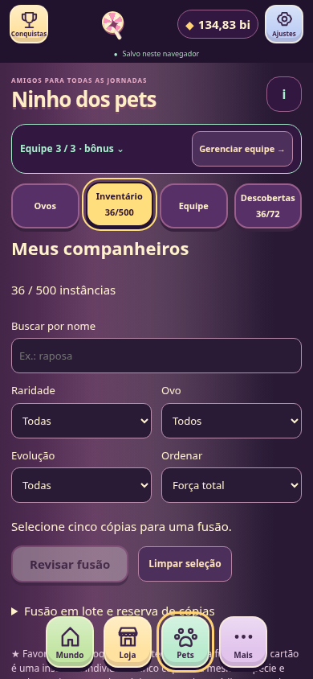
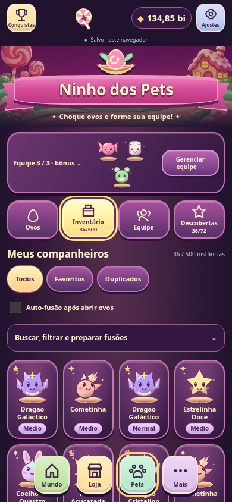
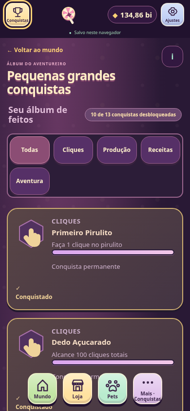
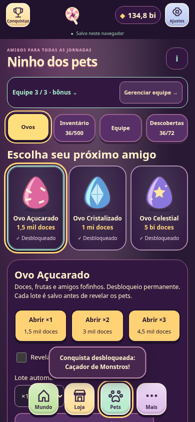
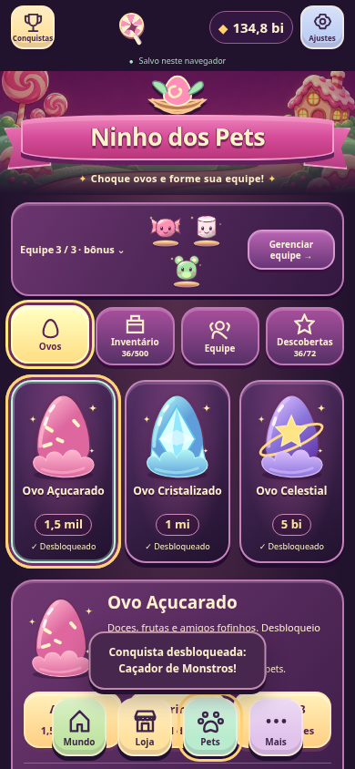

# Ninho dos Pets e álbum de conquistas

## Auditoria antes da implementação

Baseline: `73596a2` (PR #15 já integrado em main; dev atualizada por fast-forward, árvore idêntica). Testes de check/unidade/build executados antes das alterações. Referências anexadas são especificação de estilo/composição, não de preços, espécies, níveis ou conquistas. As quatro imagens recebidas mostram Mundo, Conquistas, Ovos e Inventário; não há uma quinta imagem de conquistas nem screenshots atuais anexados.

Achados confirmados em Chromium, com fixtures descartáveis:
- `js/pets/view.js` repete bônus, ID, quatro botões e seleção em cada pet. Em 390×844, `pages/pets.html` mostra filtros e ferramentas antes de qualquer personagem no inventário. O desenho fica fora da primeira viewport.
- `js/pages/achievements.js` repete artigo/progresso/descrição por conquista e quatro emblemas de categoria para 13 feitos. Falta seleção e ilustração individual.
- `js/pets/art.js` possui silhuetas simples, sem volumes/reflexos suficientes para as referências. Ausência de fita ilustrada e cenário dedicado é julgamento de direção de arte, não defeito funcional.
- A capacidade 3 está duplicada entre validação, bônus, ações e UI; `bestTeam` só enumera trios. Mudar apenas uma constante seria incorreto.
- Fusão em lote existente aceita uma espécie por vez e encadeamento explícito. Não protege referências de presets por padrão; a nova automação precisa de política mais conservadora, sem mudar a fusão manual.

As capturas reais novas ficam em `screenshots/cartoon/before`; não sobrescrevem o baseline histórico `game-hud/before`.

## Mapa/componentes decididos antes das alterações

- Preservar os dez documentos, HUD principal e as rotas; Mundo/Loja/Roleta não serão redesenhados nesta revisão.
- Ninho: cenário local decorativo + fita SVG, tira de equipe com retratos reais, quatro abas compactas; três pedestais de ovos e um detalhe contextual com compras reais. Probabilidades e opções avançadas continuam em details.
- Inventário: até 48 instâncias por página em grade; seleção de um pet abre um único detalhe com ações e flags. Ferramentas de fusão/filtros avançados em disclosures. Nenhuma instância é agrupada/perdida.
- Equipe: pedestais de 3–5 slots e ferramentas existentes; descobertas: 18 espécies e quatro estágios, detalhes sob seleção.
- Conquistas: 13 botões com arte específica, categorias reais, um único detalhe vivo e selecionável mesmo bloqueado.
- Auto-fusão: OFF, opt-in confirmado; apenas após hatch real, em foreground online e com escrita/save/update seguros. Compra + fusões na mesma transação salva; cinco iguais livres, sem equipados/favoritos/bloqueados/presets/reserva e sem encadeamento.
- Prestígio: décimo tile independente, +1 slot por compra, máximo 5. Custos propostos 25 e 75 PP, sujeitos às simulações; ledger inclui 100 PP acumulados. Schema novo com backup bruto v6, sem reset.
- Otimizador: manter exatidão de três slots, enumeração exata de pequenos inventários 4/5; busca limitada determinística para grandes equipes, com comparação exaustiva pequena e benchmark de 500.

## Resultado e revisão das imagens

Implementação em `dev`, sem merge/publicação/distribuição, versão beta e assinatura inalteradas. [Índice visual](screenshots/cartoon/INDEX.md): 32 PNGs anteriores e 41 posteriores; 144 renderizações por fase (seis superfícies × oito tamanhos × três saves), mais seleções/tema/viewport reduzida. Cada captura posterior registra a release real no JSON e recusa uma troca de build durante o ensaio. Nenhum save de jogador foi acessado. As referências são as quatro imagens visíveis no chat (Mundo, Conquistas, Ovos e Inventário).

| Referência | Resultado real / diferença deliberada |
| --- | --- |
| Ovos | Fita rosa dimensional, ninho, cenário com doces, tira com retratos reais, três pedestais com seleção e preço, um painel contextual com arte/preview. Lotes reais ×1/×2/×3; probabilidades completas em detalhe. Não se copiam preços/nomes fictícios. |
| Inventário | Grade de instâncias de 3 colunas em 320–360, 4 em 390–430, mais em desktop; nome/estágio/raridade/flags. Uma seleção abre **um dialog** de detalhe (alternativa permitida ao painel inline), com equipar/favorito/bloqueio/fusão e seleção de IDs. Sem níveis RPG ou quantidades agrupadas falsas. |
| Conquistas | Livro/troféu, fita, 13 emblemas SVG diferentes, checks dourados, bloqueados selecionáveis, categorias reais e um único detalhe/meter vivo. Na tela de 320 há três colunas; de 390, quatro. Nenhuma recompensa nova foi inventada. |
| Equipe / descobertas | Pedestais com os 3–5 membros reais; quatro conjuntos e seis estratégias mantidos. Álbum de 18 espécies/72 estágios com silhuetas e detalhe selecionável. Espaços de Prestígio têm tile próprio, independente. |
| Mundo | HUD principal preservado. Corrigida a navegação de Tab após histórico, sem redesenhar o restante do jogo. |

### Comparações de viewport 390×844, fixture intermediária

| Superfície | Documento antes | Depois medido | Leitura |
| --- | ---: | ---: | --- |
| Inventário | 13.949 px; cartões de 176×709, nenhum pet na primeira tela | aproximadamente 2.189 px; retratos de 85×133, primeira linha visível | Filtros/regras em disclosure e detalhes únicos eliminam a repetição |
| Conquistas | 3.502 px; artigos de 362×210 | aproximadamente 1.190 px; badges de 84×105 | Álbum substitui descrições repetidas |
| Descobertas | 3.752 px | aproximadamente 2.662 px | Grade de espécies e estágios selecionáveis |
| Equipe | 1.034 px | aproximadamente 985 px | Arte antes da gestão e acesso real ao próximo espaço |
| Ovos | 1.332 px | aproximadamente 1.314 px | Hierarquia visual mudou mais que a altura total; novas informações continuam disponíveis |
| Prestígio | 1.595 px | aproximadamente 1.719 px | Cresceu para acomodar a décima melhoria; nove anteriores preservadas |

Os JSONs contêm os valores por viewport/estado. Scroll continua intencional nas áreas complexas, com padding da navegação e insets. Não há afirmação de que tudo caiba numa única viewport.

Revisões feitas a partir das capturas: cenário inicial aparecia como uma faixa estreita (corrigido o enquadramento SVG); reduzida a fita em celulares; opções avançadas deixaram de preceder retratos; cartões de conquistas ainda herdavam min-height de artigo (removida); retirado subtítulo duplicado; ações do detalhe de pet passam a duas colunas no celular; retratos de equipe ampliada quebram linha mantendo alvos44px. O detalhe volta ao botão de instância atual após render, sem focar um nó removido.

| Antes | Depois |
| --- | --- |
|  |  |
|  |  |
|  |  |

### Arte e recursos

`js/pets/art.js` desenha as 18 espécies e os três ovos com gradientes, contornos, reflexos, faces/motivos e pedestais; as quatro evoluções são reais. `js/ui/cartoon.js` contém os 13 emblemas individuais, fita, ornamentos e fallback do cenário. `assets/images/locations/pet-sanctuary.webp` é uma paisagem original gerada nesta revisão com image_gen, sem texto/controles/personagens. Original retido no workspace; derivada otimizada para 1152×768 (~59 KiB), ativada explicitamente no registro. Não é uma imagem de tela nem substitui controles. SVG continua visível se a imagem falhar; tudo fica local no APK/PWA. Não se adicionam fontes/CDN/frameworks ou loops decorativos.

Não se promete equivalência pixel a pixel com a pintura dos mockups: os personagens e medalhas reais são vetores locais, os dados são do catálogo e os layouts adaptam a largura/44px. O dialog de instância é uma escolha explícita para não navegar por 48 fichas repetidas. Temas e reduced motion permanecem independentes.

## Auto-fusão: segurança e uso

No Inventário, **Auto-fusão após abrir ovos** começa OFF, inclusive em saves migrados. Ligar pede confirmação informando consumo permanente e proteções; desligar não pede confirmação. A preferência/histórico sobrevivem a navegação, backup e Prestígio; não existe execução ao carregar, migrar, importar ou retomar.

Somente um hatch real pode disparar a política automática, enquanto foreground/online/writable/save estiverem disponíveis. A verificação inicial desconhecida do PWA e a versão esperando ativação bloqueiam **apenas a consolidação automática**, mesmo após Depois; abrir ovos permanece jogável. No APK não existe updater PWA. `navigator.onLine` é o sinal local de conectividade, sem requests de rastreamento. Pausa/ocultação/ownership/update continuam parando o auto-hatcher existente.

O dry-run percorre espécies/estágios por meio do `batchFusionQuote` existente, cinco IDs distintos da mesma espécie/estágio. Favoritos, bloqueios, equipados, referências dos quatro presets e reserva ficam protegidos. Só IDs presentes no início podem ser fontes; não há encadeamento de resultados. A prévia é novamente conferida por assinatura antes do commit.

Compra, sorteios, IDs, descobertas, fusões e contadores são persistidos na mesma `runtime.act(...,{requireSave:true})`; falha de save restaura o snapshot inteiro. A aplicação das fusões também usa um draft isolado para não deixar consumo parcial se uma prévia falhar. Pedido de hatch repetido não reaplica recompensa. Capacidade500 é checada **antes** de abrir: não se consomem pets especulativamente para tornar uma compra possível.

**Buscar, filtrar e preparar fusões → Fundir duplicados elegíveis…** é uma ação avulsa com prévia de todos os IDs/resultados e confirmação. Não liga automação. A fusão manual anterior, inclusive encadeamento/consentimento para equipados, segue independente e explícita.

## Laços de Açúcar: custos, orçamento e algoritmo

Três espaços são o padrão. Compras permanentes: quarto **25 PP**, quinto **75 PP**, total100, máximo5; sem pré-requisitos artificiais entre melhorias. A compra não equipa/remove instâncias. `slots.js` centraliza capacidade/preço; ações, validação, bônus, presets, UI e melhor equipe usam a capacidade real. Produção é integrada com a equipe anterior antes de trocas; todos os cinco canais e o teto25% de PP continuam iguais.

O custo compara uma ampliação potencialmente forte com Ímpeto (+5% por nível, total210 PP) e expansões existentes. Não é um bônus barato de1 PP. [Simulação reproduzível](simulations/pet-slots.json): cenário inicial com pets Açucarados Normais ganhou3,57% PPS ao passar3→4; snapshots controlados com todos os estágios ganharam25,32% em3→4 e42,19% em3→5. São **comparações de inventários financiados**, não previsão de sorte, tempo para conseguir Gigantes ou ganho universal.

Usando `simulateJourney` real, política que reserva PP, compras de fábricas/receitas por ROI e2 cliques/s, sem Arena/boost/roleta/eventos, a primeira compra ocorreu no histórico25 (67min34s acumulados) e a segunda no100 (157min04s). A simulação de acesso aos pontos não fabrica pets nem mede seu tempo de obtenção. Outras escolhas de gasto atrasam as compras, intencionalmente.

Três slots mantêm busca exata. Para4/5, até150 mil combinações após agrupamento/poda são enumeradas; acima disso, beam de96 equipes por profundidade limita trabalho determinístico. Objetivos continuam PPS real/capacidade ativa, clique, dano real de chefe, PP real com cap/arredondamento, construção e equilíbrio. Pequenos inventários são comparados com enumeração exaustiva nas seis estratégias. Em inventários grandes4/5 a busca **pode perder o ótimo global**; o texto de estratégia explica isso. Empates usam aquisição/ID e ordem estável dentro da busca.

Benchmark Node:500 instâncias,3/4/5 slots, seis estratégias, cinco repetições; maior mediana ~19ms nesta execução, maior amostra ~32ms. [Medições do navegador](simulations/cartoon-browser-performance.json) incluem handler real + save/DOM, com CPU Chromium limitada a4×. Nenhum desses números prova FPS/bateria/desempenho de telefone físico. Apenas48 retratos são renderizados por página e ticks não reconstroem a grade; navegação repetida mantém o DOM limitado.

## Migração e compatibilidade

Schema7 na mesma `lollipopSave`. v6 original em `lollipopSave.legacy-v6`, com confirmação de escrita/readback antes da primeira substituição; backups v5/v4 e recovery permanecem. Ajustes permite exportar também o bruto v6. `petSlotUpgradeLevel` default0, inteiro0–2, despesas25/75 incluídas no orçamento histórico depois das melhorias já existentes. Nível inválido/sem suporte de PP protege o original; não se inventa saldo nem se reembolsa/apaga a progressão. Opt-in defaultOFF, histórico validado, equipe/presets normalizados com capacidade comprada. Versões futuras são protegidas, sem sobrescrita.

Mantidos:18 espécies, três ovos/preços/chances,72 descobertas,13 IDs/requisitos de conquista, quatro presets, seis estratégias, estágios e fusão cinco-para-um, reservas/proteções, moedas, ledger PP extra, fábricas inativas, música/Jukebox, skins/temas/partículas, Receitas/rotas collection, ownership, updatePWA, backup/export/import e telas reais. Novo APK é necessário para atualizar assets Android; Service Worker não atualiza APK. Um backup schema7 exige código atual para importar.

## Validação executada e limites

Baseline: npm ci, check,257 unitários/build e89 Pets passaram. **HUD falhou antes da mudança** no teste de contenção de foco após Back/Forward. O handler antigo cobria limites de Tab apenas dentro do dialog, deixando estados de foco restaurado/fora da lista sem cobertura. A correção captura Tab no documento quando o modal está aberto e percorre a lista viva/visível, inclusive quando o foco começa fora. A asserção original continua; não foi removida ou relaxada.

Na integração da auto-fusão, foi confirmada uma particularidade de `wait_for_function`: um predicado async resolvendo false era retornado imediatamente nesta versão de Playwright. A espera agora aguarda a Promise explicitamente via evaluate e observa registro/controller/banner com predicado síncrono. A guarda do jogo continuou preservando as cópias durante a verificação; não se relaxou a asserção de fusão única.

No QoL, o listener de notificação do prazo de1,6s era instalado depois de goto(networkidle); o jogo podia emitir durante esse intervalo. Agora o teste observa desde o início do documento, mantendo a exigência de exatamente um aviso. Não se alterou combate para contornar o teste. Seletores antigos de pet foram adaptados para abrir o detalhe/disclosure real; assertivas de custos, IDs, rollbacks e resultados foram mantidas. O teste de arte agora inclui também o registro local de cenário/pets/ovos.

Resultados locais: npm ci; check (63 JS/10 HTML); **306 unitários**; build PWA; **1.129 verificações Chromium** (gerais112, QoL122, Prestígio60, música62, arte13, UI379, Pets90, HUD109, PWA33, cartoon149). Simulações `balance`, Pets, Prestígio e espaços executadas. Matriz visual:288 renderizações comparáveis, sem pageerrors ou overflow horizontal. Android sync/check e assembleDebug/assembleDebugAndroidTest locais com JDK21/SDK35 passaram, sem distribuir os APKs isolados.

Os resultados da instrumentação CI e seu SHA são registrados no PR/entrega após a execução; compilação não é teste de aparelho. Backend Android `-gpu swangle` mantido e smoke obrigatório intacto. Não houve telefone físico, Safari/Firefox, saída física de som, teclado/notch real, acessibilidade com leitor de tela físico, medição de FPS/bateria ou playtest prolongado. Safe-area e viewport reduzida são verificações de layout, não emulação completa de IME/notch.

### Conferência manual Android antes de uma futura distribuição

1. Instalar uma build de teste compatível com a assinatura já usada, sem desinstalar para contornar conflito; exportar backup primeiro.
2. Em avião, abrir as dez páginas, fazer compras/cliques, ouvir música após gesto e reiniciar o app. Auto-fusão deve ficar suspensa offline; hatch manual continua.
3. Testar ovos×1/×2/×3, resultados persistidos, grade/filtros, cinco fontes, favoritos/bloqueios/reserva/conjuntos e cancelamento das confirmações.
4. Comprar quarto/quinto espaço com saldo legítimo; equipar estratégias/presets, trocar/desequipar sem renda retroativa, renascer e importar/exportar backup.
5. Pausar/retomar e matar/reabrir o app; auto-hatch não deve voltar sozinho. Voltar fecha detalhes/dialogs antes de sair da página; fechar Loja/Roleta mantém estado.
6. Conferir texto ampliado, teclado, paisagem, notch/system bars, últimos itens acima do dock e ausência de travamentos em sessões longas.

## Arquivos alterados

Lista de fontes, testes e documentos; os PNGs/JSONs visuais estão individualmente no [índice](screenshots/cartoon/INDEX.md).

```text
.github/workflows/pages.yml
AGENTS.md
README.md
assets/images/locations/pet-sanctuary.webp
css/cartoon.css
docs/ART_GUIDE.md
docs/CARTOON_FIDELITY.md
docs/PETS_UPDATE.md
docs/simulations/cartoon-browser-performance.json
docs/simulations/pet-slots.json
js/data.js
js/gameplay.js
js/pages/achievements.js
js/pages/pets.js
js/pages/prestige.js
js/pages/settings.js
js/pets/actions.js
js/pets/art.js
js/pets/auto-fusion.js
js/pets/bonuses.js
js/pets/evolution.js
js/pets/inventory.js
js/pets/slots.js
js/pets/state.js
js/pets/view.js
js/progression.js
js/pwa/update.js
js/storage.js
js/ui/assets.js
js/ui/cartoon.js
js/ui/panels.js
pages/achievements.html
pages/pets.html
pages/prestige.html
pages/settings.html
scripts/simulate-pet-slots.mjs
tests/artwork.test.js
tests/balance.test.js
tests/browser_smoke.py
tests/cartoon-fixtures.mjs
tests/cartoon_browser.py
tests/cartoon_capture.py
tests/economy.test.js
tests/game_hud_browser.py
tests/music_browser.py
tests/pet-slots-fusion.test.js
tests/pet_ui_helpers.py
tests/pets.test.js
tests/pets_browser.py
tests/prestige_browser.py
tests/qol_browser.py
```
