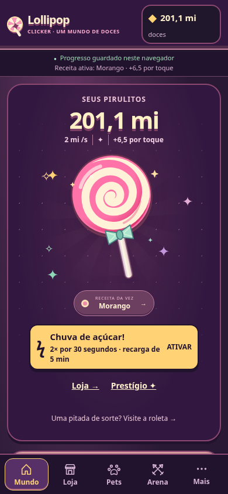
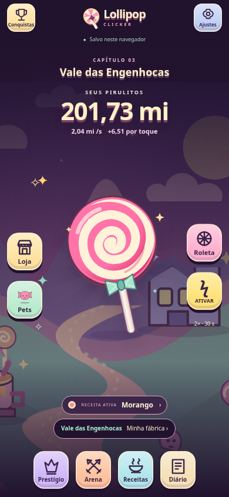
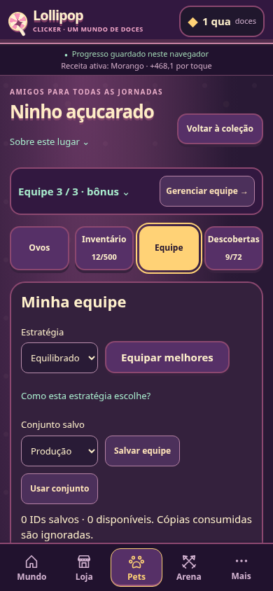
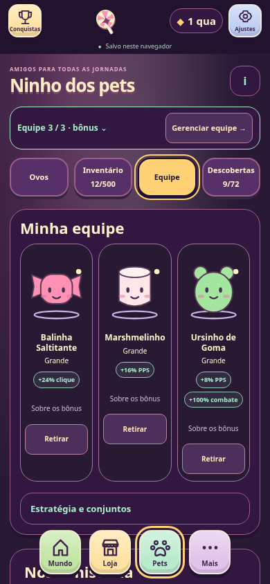
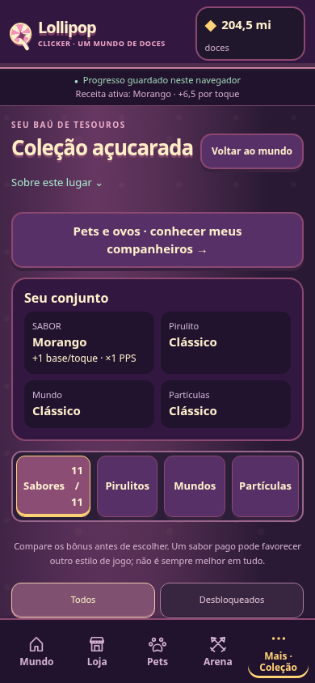
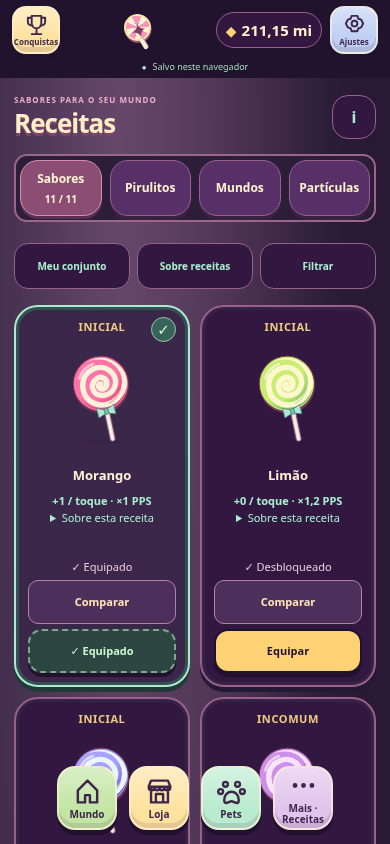

# HUD do jogo — auditoria, mapa e validação

## Baseline real antes da implementação

Branch dev em 6c907d7; origin/main 5cfca99 contém a mesma árvore (diff sem alterações). Nenhum ZIP adicional disponível foi usado para substituir trabalho vivo. Build PWA e1e04182ffab, Chromium real, subpath /Lollipop-Clicker-TEST/, 8 viewports × 3 estados descartáveis × 9 superfícies (inclui Equipe): 216 renderizações, 28 PNGs e nenhum pageerror. Fixtures criadas com createState/validateState; nunca acessam save real. [Índice antes](screenshots/game-hud/before/) e layout.json contêm dimensões/ações visíveis por combinação. O saldo recebe produção real; capturas não congelam nem adulteram o relógio.

Fatos medidos em estado intermediário: cabeçalho 108 px em 320×568, 131 px em 390×844, 104 px em 1280×720. Home em 390 tem documento de 1.429 px; Loja 2.036 px, Pets 1.468 px, Prestígio 3.178 px. Em 320, Prestígio chega a 3.577 px. O preço de Ovo Celestial aparece como 5.000.000.000 em um cartão de aproximadamente 115 px; ×2 custa10 bilhões. Em desktop, três colunas dividem a atenção igualmente. Isso é dado de DOM/captura; julgar o resultado como dashboard e desejar foco no pirulito é direção de design do usuário.

`shared.js` abre quatro atalhos + Mais e repete carteira/receita; `home.js` monta a Loja integral junto à cena; `pets.js` usa formatter local inteiro; `prestige.js` expõe explicações e nove compras em sequência. Fontes de verdade preservadas: buyBulk/quotes, progression, pets/actions, storage e runtime.

## Mapa decidido antes das alterações

| Área | Interação proposta |
| --- | --- |
| Mundo | Campo central com pirulito, saldo e taxa; cenário em segundo plano, sem três painéis iguais |
| Topo | Marca pequena, Conquistas e Ajustes nos cantos; save compacto, avisos completos no fluxo |
| Laterais | Tiles Loja/Pets/Roleta e bônus; área central desobstruída |
| Base | Prestígio, Arena, Receitas e Diário em tiles; em documentos secundários, retorno e explorador compacto |
| Loja | Drawer nativo dialog, scroll interno, x1/x10/x100/MAX e oito fábricas via mountShop; fallback pages/shop.html permanece |
| Roleta | Mesmo controlador reutilizável no dialog e na rota rewards; fechar não cancela giro persistido |
| Mundo/fábricas | Detalhes da produção por ação explícita; açúcar dourado continua alcançável |
| Pets | Tela própria, retratos/ovos maiores, bônus curtos e detalhes disponíveis; equipe e auto mantidos |
| Prestígio | Santuário com nove escolhas independentes e um detalhe selecionado, sem dependências inventadas |
| Arena | Cena de batalha com chefe/HP/ação dominantes e instruções opcionais |
| Receitas | Nome visível novo; route collection, IDs e save continuam iguais; quatro categorias independentes |
| Números | Módulo de apresentação único, compacto/decimal/exato, arredondamento de custo honesto e aria exata |

Overlays usam um único runtime, dialog modal/foco, histórico para Back/Forward, Escape/Voltar fecha antes de sair e foco retorna ao atalho. Deep links reais e rotas offline ficam compatíveis. Os testes antigos serão adaptados apenas onde a interação mudou, mantendo as verificações transacionais.


## Resultado implementado e revisão visual

O Mundo agora ocupa uma única viewport nos oito tamanhos ensaiados, com o pirulito central e cenário integrado. Utilitários no topo; Loja/Pets/Roleta/bônus nas laterais; Prestígio/Arena/Receitas/Diário na base. O dock não tem a faixa de cinco abas nem exige Mais no hub. Nas páginas próprias, Mundo/Loja/Pets/Mais formam o retorno/explorador compacto. Não se transformou o projeto em SPA: dez documentos continuam navegáveis e offline.

A Loja é um dialog com compra reutilizada, oito fábricas, ganho real de PPS, preço compacto, estado/capacidade e detalhes com valores completos. O fallback `pages/shop.html` mantém inclusive Normal/Compacta. A Roda é o mesmo mountWheel no hub e no documento rewards; fechar interrompe somente a animação, e não a recompensa persistida. Ambos têm histórico Back/Forward, Escape, Voltar Android via contrato de close, ciclo de foco, foco devolvido ao atalho, scroll interno e proteção contra click-through. A abertura repetida não aumenta o DOM nem duplica compras. Compra/notificação dentro do modal usa o anúncio visível do próprio painel; o toast do fundo não anuncia em duplicidade. Um update PWA real é sinalizado também no painel; a ativação continua no updater original, após fechar. Não há promessa de atualização de APK via SW.

Pets mantém tela ampla: rostos/equipe antes dos controles de estratégia/presets, bônus em chips e explicação disponível, probabilidades acessíveis inclusive para ovo bloqueado. Auto, cinco fontes, consentimentos, flags, presets e reserva não mudaram. Prestígio tem nove tiles reais, independentes: seleção mostra um detalhe de compra; não há conexões/pré-requisitos inventados. Renascimento exibe resumo curto e mantém a confirmação completa, base/extra/total em detalhes. Arena concentra guardião, vida, dano, prazo e desafio no palco. Receitas mostra arte/bônus/ação antes do conjunto e filtros opcionais. Ajustes, Jukebox, backups, export/import e reset deliberado ficam preservados; Conquistas/Diário usam o mesmo HUD.

A revisão das capturas levou a correções específicas: retirar a min-height legada que cortava o pirulito em paisagem; corrigir uma chamada de formatter que interrompia as linhas da Loja; colocar pets antes dos controles; trazer receitas/bonus antes dos filtros; reduzir o resumo de Prestígio e disponibilizar as escolhas mais cedo; acrescentar ciclo explícito de Tab e sticky-header medido no drawer. Safe areas usam env em topo, laterais, base e dialog; o ResizeObserver acompanha header e aviso. Notches físicos ainda precisam de playtest em aparelho.

### Comparações reais

| Antes | Depois |
| --- | --- |
|  |  |
|  |  |
|  |  |

[Índice completo de 72 PNGs reais](screenshots/game-hud/INDEX.md): 28 antes, 44 depois, com os oito viewports, três progressos, drawer em320/390/1280 e paisagem, Roda, Equipe, ovo/lote grande, Prestígio selecionado, Arena, quatro categorias, Ajustes e tema neon/reduced motion. Sem mockups, arquivos de usuário ou manipulação dos números para a imagem. As métricas JSON de antes/depois totalizam 432 renderizações; cada fase percorre216. Screenshots são de viewport, não uma imagem longa que simula primeira tela. Detalhes abertos têm capturas próprias.

| Documento / estado intermediário 390×844 | Altura antes | Altura depois |
| --- | ---: | ---: |
| Cabeçalho | 131 px | 78 px |
| Mundo | 1.429 px | 844 px (uma viewport) |
| Loja fallback | 2.036 px | 1.736 px |
| Pets / Ovos | 1.468 px | 1.332 px |
| Pets / Equipe | 1.773 px | 1.034 px |
| Prestígio | 3.178 px | 1.595 px |
| Arena | 1.179 px | 998 px |
| Receitas | 3.117 px | 2.826 px |
| Roda fallback | 1.585 px | 1.217 px |
| Ajustes | 2.122 px | 2.006 px |

Não havia overflow horizontal do documento no baseline; o problema confirmado era altura/hierarquia e preços longos. Depois: zero overflow horizontal nas216 combinações, pirulito e atalhos desobstruídos nos oito viewports. Todos os atalhos HUD têm área >=44×44. Amostras de contraste WCAG de cores sólidas: texto dos tiles/dourado10,57:1; creme/fundo15,71:1; texto secundário/Loja6,33:1; botão indisponível6,53:1. Esses valores não são uma auditoria completa de cada pixel sobre cenário.

### Percursos (saldo/requisitos já suficientes)

| Ação partindo do Mundo | Antes | Agora |
| --- | --- | --- |
| Comprar fábrica | desktop1; celular scroll + disclosure/compra | Loja + compra:2, sem sair do hub |
| Abrir ovo padrão | Pets + abrir, com scroll até os controles | Pets + abrir:2; ovo diferente acrescenta seleção; revelação mantém Continuar |
| Girar | Mais + Roleta + girar:3 | Roleta + girar:2 |
| Trocar sabor | badge visível1 ou Mais2 + equipar | Receitas + equipar:2 |
| Desafiar guardião | Arena + desafiar:2 | Arena + desafiar:2; atacar ainda depende do combate real |
| Comprar expansão | Mais + Prestígio + compra/scroll | Prestígio + tile + compra:3 |
| Ajustes / Conquistas / Diário | Mais + destino:2 | um tile:1 |

Contagens distinguem navegação de ações de jogo e não incluem os cliques necessários para ganhar doces; não se promete que toda operação exige menos toques. Lotes, confirmações, probabilidades e restrições continuam reais.

## Receitas, números e preservação

O nome visível é Receitas em títulos, HUD, links e rótulos acessíveis. A rota continua `collection` / `pages/collection.html`; activeFlavor/activeSkin/activeTheme/activeParticles, unlocked arrays e IDs não mudaram. Até a categoria técnica Coleção das conquistas continua a mesma nos atributos, mapeada apenas na apresentação. Pet álbum e biblioteca musical continuam podendo usar o substantivo genérico coleção. As quatro seleções foram compradas/equipadas independentemente e verificadas após reload no teste novo.

`js/format.js` é a única implementação de Intl para números de economia: 950;1,5 mil;1,25 mi;10 bi;2,7 tri; negativos/valores pequenos; não finitos viram — e expoentes altos têm aproximação explícita. Custo compacto arredonda para cima; preço exato fica em aria/title e nos detalhes da Loja; Diário oferece valores exatos. Percentual, decimal e multiplicador têm helpers próprios; tempo mantém unidade própria. Exemplo real: Ovo Celestial custa5 bi; lote×2 mostra10 bi e aria10.000.000.000. A regressão com4.999.999.999 recusa o ovo de5 bilhões, mantém o saldo inteiro e diz que falta1. O estado nunca passa por formatação antes de preço, débito ou save. ×1,68 passou a exibir duas casas, substituindo a antiga aproximação ×1,7.

`gameplay.js`, `data.js`, `progression.js`, `storage.js`, schema, versões, package ID e assinatura não mudaram. Em runtime.js somente o texto numérico do aviso de prêmio usa o formatter compartilhado; lifecycle/ownership/writer ficaram intactos. Em pets/actions.js só a apresentação do saldo que falta mudou. Sem novo clock, loop decorativo, framework, CDN ou dependência de execução. A Loja fechada evita render; detalhes não reconstroem DOM sem mudança; a Roda só anima enquanto gira visível. Não foram medidos FPS/bateria em hardware antigo.

## Validação executada

Ambiente local: Node24.22.1, Python Playwright, Chromium155.0.8059.79 real; build PWA gerado e testado sob /Lollipop-Clicker-TEST/ e raiz. Contextos isolados; nenhuma sessão real foi lida ou sobrescrita.

| Comando | Resultado local |
| --- | --- |
| npm ci | passou, lockfile e dependências preservados |
| npm run check | 59 JS / 10 HTML passaram |
| npm test | 257 testes passaram |
| npm run pwa:build | 64 arquivos obrigatórios /65 assets; hash automático |
| npm run test:browser | 112 verificações passaram |
| python3 tests/qol_browser.py | 122 passaram |
| python3 tests/prestige_browser.py | 60 passaram |
| npm run test:pets | 89 passaram |
| python3 tests/music_browser.py | 62 passaram, incluindo decodificação real OGG no Chromium |
| python3 tests/artwork_browser.py | 13 passaram |
| npm run test:pwa | 33 passaram, incluindo update real anunciado no modal |
| python3 tests/ui_system_browser.py | 379 passaram |
| python3 tests/game_hud_browser.py | 109 passaram; transações, modal, histórico, foco, quota, ownership, números extremos e offline |
| python3 tests/game_hud_capture.py before / after | 216 renderizações em cada fase;0 pageerrors |
| npm run android:sync + node scripts/check-android.mjs | dez documentos/arquivos locais e ID estável conferidos |
| Gradle :app:assembleDebug :app:assembleDebugAndroidTest --offline, JDK21/SDK35 | build isolado compilado;125 tarefas |

São979 verificações de navegador nas suítes acima, além das matrizes visuais. Não se somaram tentativas interrompidas à contagem. Expectativas antigas foram adaptadas para abrir disclosures/selecionar tiles e comparar a nova apresentação; não se removeram asserções econômicas, de rollback, fusão ou persistência. Campo de jogo agora é decorativo fora de botões: o clique em h1 que só precedia uma screenshot virou movimento do mouse; o clique real no pirulito continua testado.

Instrumentação Android permanece obrigatória, preservando -gpu swangle. Foram mantidos os três testes anteriores e acrescentado Voltar nativo em Loja/Roleta; navegar os dez documentos usa o fallback real do modal. Build local não é execução no WebView. O resultado real do CI e o SHA validado são informados no PR/entrega. Não houve teste em telefone físico, Safari/Firefox, instalação OS de PWA nem avaliação de bateria nesta tarefa. Nenhum APK foi distribuído; Pages só publica main, intocada.

## Conferência manual Android recomendada

1. Abrir Mundo, tocar rapidamente com mais de um dedo, comprar em Loja e usar Voltar: painel fecha, pirulito responde e não há toque duplicado.
2. Girar, fechar/ocultar/reabrir: mesmo prêmio e cooldown, sem novo sorteio/pagamento. Conferir som e movimento reduzido.
3. Conferir safe areas e fonte ampliada em aparelho com recorte; acesso a X, avisos de save/update e exportação. Paisagem foi simulada no navegador; a orientação padrão do APK continua retrato.
4. Percorrer Pets/Equipe/presets/fusão e as quatro categorias de Receitas, depois reabrir o app: seleção/progresso continuam. Testar export/import por seletor Android mantendo as confirmações originais.
5. Conferir os checks obrigatórios do PR e revisar antes de qualquer merge/distribuição. A tarefa não autoriza fazê-los automaticamente.

## Arquivos alterados

Fontes/testes/documentos abaixo; os72 PNGs e os2 JSONs estão discriminados no [índice visual](screenshots/game-hud/INDEX.md). Superfícies antigas conscientemente preservadas: Loja Normal/Compacta e Roleta em documento próprio, toda Jukebox/recuperação, presets/auto/fusões e as dez rotas.

```text
.github/workflows/pages.yml
AGENTS.md
README.md
android/app/src/androidTest/java/com/ermzy/lollipopclicker/GameOfflineTest.java
css/ui-system.css
docs/GAME_HUD_REDESIGN.md
docs/android/SMOKE_TESTS.md
index.html
js/core/runtime.js
js/format.js
js/pages/achievements.js
js/pages/arena.js
js/pages/collection.js
js/pages/home.js
js/pages/pets.js
js/pages/prestige.js
js/pages/rewards.js
js/pages/settings.js
js/pages/statistics.js
js/pets/actions.js
js/pets/view.js
js/ui/panels.js
js/ui/shared.js
js/ui/shop.js
js/ui/wheel.js
pages/achievements.html
pages/arena.html
pages/collection.html
pages/pets.html
pages/prestige.html
pages/rewards.html
pages/settings.html
pages/shop.html
pages/statistics.html
tests/artwork_browser.py
tests/browser_smoke.py
tests/format.test.js
tests/game_hud_browser.py
tests/game_hud_capture.py
tests/hud-fixtures.mjs
tests/hud_helpers.py
tests/music_browser.py
tests/pets_browser.py
tests/prestige_browser.py
tests/pwa_browser.py
tests/qol_browser.py
tests/ui_system_browser.py
```
