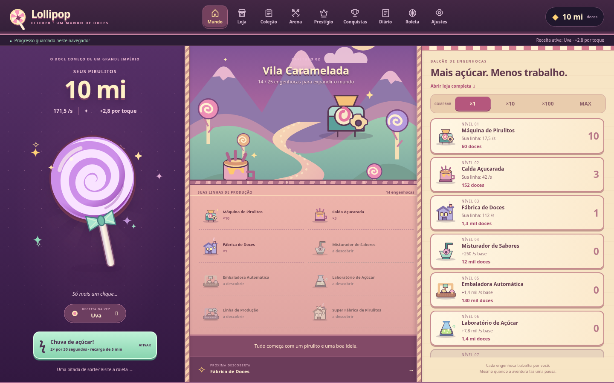
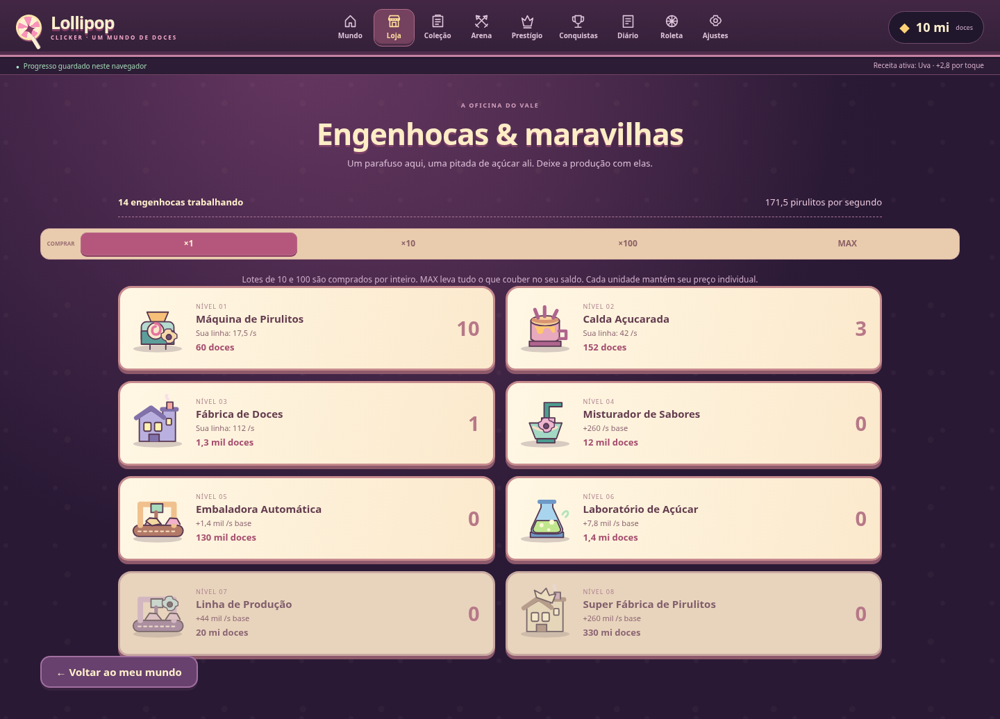
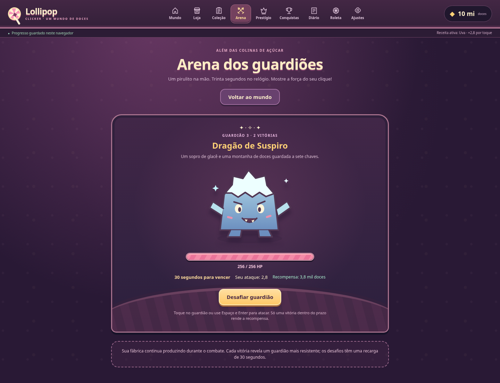

# Lollipop Clicker 3.0 em jogo

Capturas de Chromium em 1440 × 900 e 390 × 844, usando o save de teste da versão 2.0 migrado para a versão 3.0. Movimento reduzido foi ativado para as capturas; as notificações transitórias foram ocultadas somente durante a fotografia. As verificações funcionais são registradas em [VALIDATION.md](VALIDATION.md).

## Mundo dos doces

## Oficina de engenhocas

## Arena dos guardiões

## Atualização de qualidade de vida

As capturas acima registram a interface anterior a este polimento. As novas capturas abaixo usam Chromium em 390 × 844, com a mesma fixture migrada, movimento reduzido e notificações transitórias ocultas:

- [Loja normal](screenshots/qol/mobile-shop-normal.png)
- [Loja compacta](screenshots/qol/mobile-shop-compact.png)
- [Coleção e comparação de sabores](screenshots/qol/mobile-collection-comparison.png)

Veja os [resultados e limites desta atualização](QOL_UPDATE.md). A barra fixa aparece na posição da viewport nas capturas de página inteira; o teste verifica que o fim do conteúdo pode ser rolado acima dela.

## Música e refinamentos móveis

Capturas mais recentes, em 390 × 844, com o catálogo real (somente a trilha original), movimento reduzido e notificações transitórias ocultas:

- [Jukebox Açucarada nos Ajustes](screenshots/music/mobile-jukebox.png)
- [Loja compacta, com introdução e linhas menores](screenshots/music/mobile-shop-compact.png)
- [Coleção com filtros](screenshots/music/mobile-collection-filters.png)
- [Comparação em painel inferior, sem salto para o topo](screenshots/music/mobile-comparison-sheet.png)

Veja os [resultados e limites da validação musical](MUSIC_UPDATE.md) e o [guia para acrescentar faixas](MUSIC_GUIDE.md).
